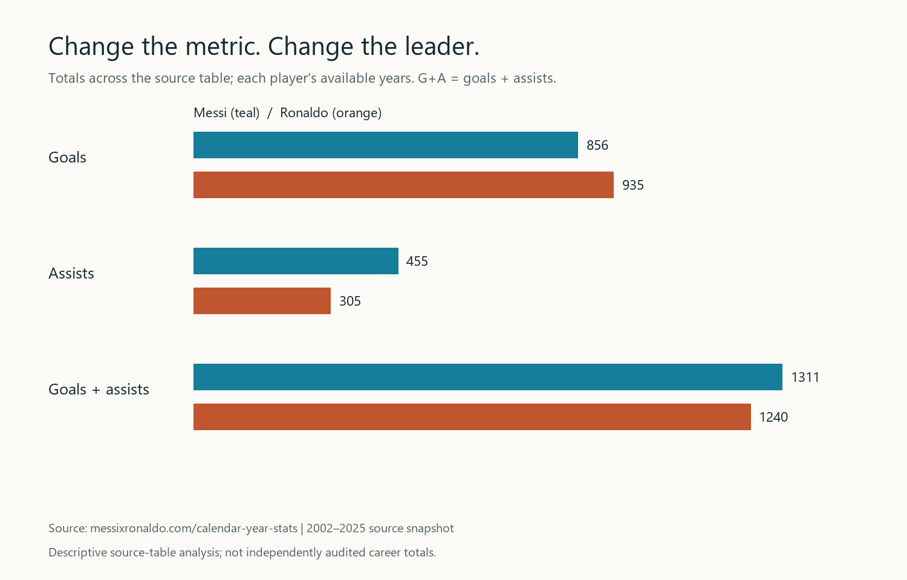
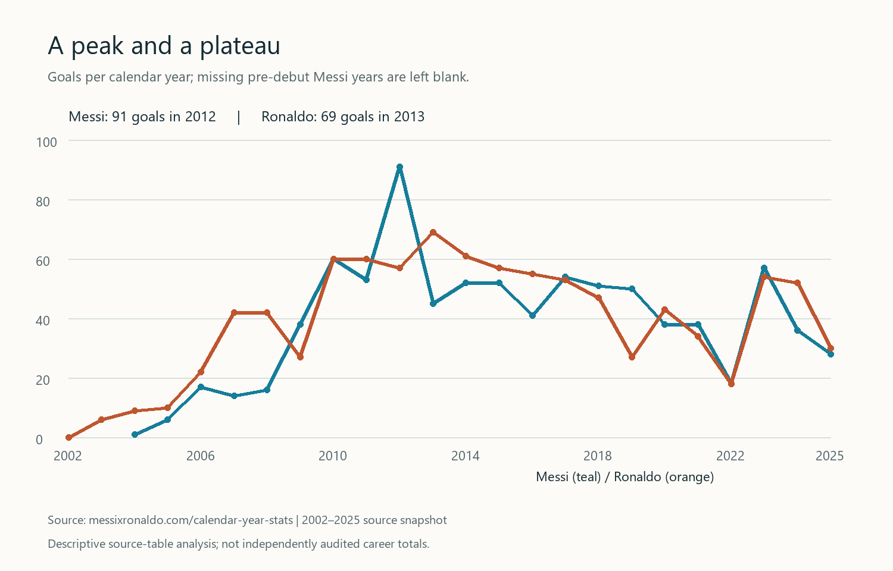

LI SIWEI · STUDENT DATA SCIENCE PORTFOLIO

<h1>Making the question as clear as the chart.</h1>

I am LI SIWEI, a CISC7204 student at the University of Macau. I am learning to turn data into reproducible analyses and visual explanations, with careful attention to what each metric can—and cannot—tell us.

PythonData cleaningExploratory analysisData visualizationGit & GitHubReproducible workflows

<h2 id="project">Selected project</h2>

ONGOING · independent source validation

<h3>Messi vs Ronaldo: how the metric changes the story</h3>

Who appears ahead when “performance” means goals, assists, or both?

This project extends my Practice 07 visualization into a reproducible portfolio case study. It compares annual values and accumulated contributions in one source table for 2002–2025. The incomplete 2026 year is excluded.

<strong>+79</strong>Ronaldo's lead in goals

<strong>+71</strong>Messi's lead in goals + assists

<strong>24 years</strong>Source-table observation window

Figure 1. The apparent leader changes with the metric. These are calculated values from the attributed source snapshot, not independently audited career totals.

Ronaldo leads in goals, while Messi leads when assists receive equal weight. This reversal shows why choosing a metric is part of the argument. It does not establish one objective “greatest player.”

Figure 2. Annual output separates a single-year peak from sustained scoring. The source records 14 Ronaldo years and 11 Messi years with at least 40 goals.

<strong>Workflow:</strong> parse the source table → validate years and missing values → verify the snapshot hash → calculate totals and rates → generate two charts. The repository includes Python code, dependency instructions, and machine-readable results.

<strong>Read the limitation with the finding.</strong> This is a descriptive analysis of a fan-maintained table. Its annual figures still require independent auditing. The source uses a broad assist definition, the players have different career windows, and per-appearance rates do not adjust for minutes or competition strength. <strong>Dribbling is not measured, and penalty goals are not separated from non-penalty goals.</strong> The selected metrics cannot cover every aspect of performance.

<strong>Data and permissions:</strong> <a href="https://messixronaldo.com/calendar-year-stats">source table</a> · <a href="https://messixronaldo.com/methodology">source methodology</a>. No explicit open-data license was found on the inspected pages. Raw source data and website assets are not redistributed; the repository documents this restriction and retrieves the public table when run.

<a class="button" href="https://github.com/LISIWEI-UM/data-science-project">Explore the code &amp; reproduction steps ↗</a>

<h2>What I will improve next</h2>

Audit annual observations against independent match records, establish data reuse permissions, and compare a common career window. Following peer feedback about limited dimensions, I will also consider dribbling and penalty/non-penalty breakdowns when reliable, consistently defined data are available.

<h2>About this work</h2>

This portfolio demonstrates developing skills in transparent measurement, visual communication, and reproducibility. It presents one focused coursework project. AI assistance through GPT-6 in the Codex desktop app helped with code, charts, writing, and site preparation; the project repository documents its role.

